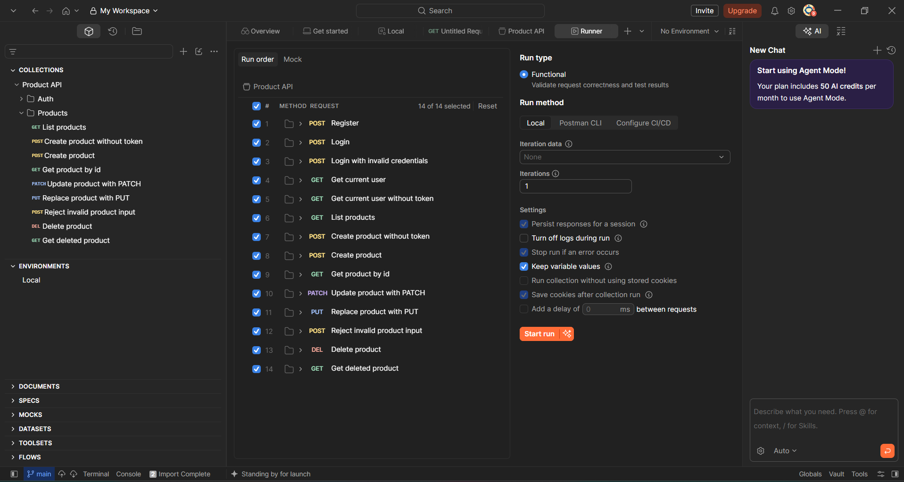
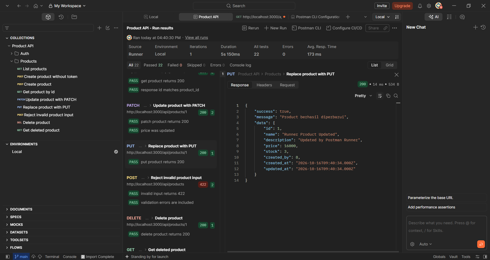

# LMS Platform

A full-stack Learning Management System (LMS) with JWT authentication, protected Product CRUD endpoints, and a separate Course API. The Day 48 assignment deliverables include the Auth and Products Postman collection, a local Postman Environment, automated API tests, and an OpenAPI specification.

## Features

- Browse course listings and view course details.
- Search courses by title, filter by level, and sort by rating, enrollment count, or duration.
- Register and log in; authenticated requests use JWT bearer tokens.
- Create, list, read, update, and delete Products; all Product mutations require a valid JWT.
- Create, update, and delete courses as an instructor. Instructors can only update or delete their own courses.
- Create and delete categories in the admin category screen. The category API also provides a protected update endpoint.
- Validate course data and return appropriate API errors for invalid input, missing records, and unauthorized actions.

## Tech Stack

- **Frontend:** React, React Router, Vite
- **Backend:** Node.js, Express
- **Database:** MySQL (`mysql2`)
- **Authentication:** JSON Web Tokens and `bcryptjs`

## Project Structure

```text
backend/
  app.js                 Express app and API route mounting
  server.js              API server entry point
  config/                MySQL connection pool
  controllers/           Request handling and validation
  db/schema.sql          MySQL schema, starter users, courses, and products
  middleware/            JWT authentication and role authorization
  repositories/          MySQL queries
  routes/                API route definitions
  test/                  Auth and Product HTTP integration tests
  postman/               Product API collection and local Environment
  docs/openapi.yaml      Auth and Product API documentation
frontend/
  src/pages/              Course, account, dashboard, and category screens
  src/components/         Shared UI components
  src/services/api.js     Frontend API requests
```


## Requirements

- Node.js 22.12 or newer
- npm
- MySQL Server

## Getting Started

### 1. Set up the database

From the project root, run the SQL script using your MySQL client. It creates the `lms_platform` database, its tables, and starter records.

```sh
mysql -u root -p
```

At the MySQL prompt, run `SOURCE backend/db/schema.sql;` from the project root. Alternatively, open `backend/db/schema.sql` in MySQL Workbench and execute it.

### 2. Configure and run the backend

Copy `backend/.env.example` to `backend/.env`, then fill in your local MySQL credentials and a private JWT secret:

```powershell
Copy-Item backend/.env.example backend/.env
```

Never commit `backend/.env`; `.gitignore` excludes it. `JWT_SECRET` must be a private random value, not the example placeholder.

Install dependencies and start the API:

```sh
cd backend
npm install
npm run dev
```

The API is available at `http://localhost:3000`; its routes are under `/api`. The root endpoint (`GET /`) can be used to check that the server is running.

### 3. Configure and run the frontend

In a second terminal, create `frontend/.env`:

```dotenv
VITE_API_URL=http://localhost:3000/api
```

Then install dependencies and start Vite:

```sh
cd frontend
npm install
npm run dev
```

Open the local URL printed by Vite (typically `http://localhost:5173`). Keep both development servers running while using the app.

## API Overview

All endpoints return JSON. Protected endpoints require `Authorization: Bearer <token>`; obtain a token from `POST /api/auth/login`.

| Method | Endpoint | Access | Description |
| --- | --- | --- | --- |
| `POST` | `/api/auth/register` | Public | Register an account |
| `POST` | `/api/auth/login` | Public | Log in and receive a JWT |
| `GET` | `/api/auth/me` | Authenticated | Get the current user |
| `GET` | `/api/courses` | Public | List courses; accepts `search`, `category_id`, `level`, `sort_by`, and `order` query parameters |
| `GET` | `/api/courses/:id` | Public | Get a course by ID |
| `POST` | `/api/courses` | Instructor | Create a course |
| `PUT` | `/api/courses/:id` | Course-owning instructor | Validate and update a course |
| `DELETE` | `/api/courses/:id` | Course-owning instructor | Delete a course |
| `GET` | `/api/categories` | Public | List categories |
| `GET` | `/api/categories/:id` | Public | Get a category by ID |
| `POST` | `/api/categories` | Admin | Create a category |
| `PUT` | `/api/categories/:id` | Admin | Update a category |
| `DELETE` | `/api/categories/:id` | Admin | Delete a category |
| `GET` | `/api/products` | Public | List products |
| `GET` | `/api/products/:id` | Public | Get a product by ID |
| `POST` | `/api/products` | Authenticated | Create a product |
| `PUT` | `/api/products/:id` | Authenticated | Replace a product |
| `PATCH` | `/api/products/:id` | Authenticated | Partially update a product |
| `DELETE` | `/api/products/:id` | Authenticated | Delete a product |

Product create and replace requests accept `name` (required, up to 150 characters), `price` (required, number greater than or equal to zero), `description` (optional string), and `stock` (optional non-negative integer, defaults to `0`). PATCH accepts one or more of those fields. Product writes require a JWT Bearer token.

Course sorting supports `rating`, `enrolled_count`, and `duration`; `order` accepts `asc` or `desc`. Course create/update requests require `title`, `description`, `rating`, `category_id`, `level`, and `duration`. Updates also require `status`; new courses default to `draft`. `thumbnail` is optional. Allowed levels are `beginner`, `intermediate`, `advanced`, and allowed statuses are `draft`, `published`.

### Update a course

```sh
curl -X PUT http://localhost:3000/api/courses/1 \
  -H "Authorization: Bearer YOUR_JWT_TOKEN" \
  -H "Content-Type: application/json" \
  -d '{"title":"Updated course title","description":"Updated course description","rating":8.5,"category_id":1,"level":"intermediate","duration":900,"thumbnail":"course.jpg","status":"published"}'
```

### Delete a course

```sh
curl -X DELETE http://localhost:3000/api/courses/1 \
  -H "Authorization: Bearer YOUR_JWT_TOKEN"
```

The API returns `401` for missing or invalid authentication, `403` when the user lacks the required role or does not own the course, `404` when a requested record does not exist, and `422` when request validation fails.

New accounts must have a name, a valid email, and a password with at least 8 characters. Passwords are stored as bcrypt hashes. Registration always assigns the `student` role; elevated roles must only be assigned by trusted database administration.

## Checks

Run the backend auth and product API tests from `backend/`. These tests start ephemeral HTTP servers and use in-memory repositories, so MySQL is not required:

```sh
cd backend
npm test
```

For database-backed testing in Postman:

1. Start MySQL and the backend, then import `backend/postman/Product API.postman_collection.json` and `backend/postman/Local.postman_environment.json`.
2. Select the `Local` environment and enter a private password of at least 8 characters in its `password` value. The supplied environment intentionally contains no real credentials.
3. Run the entire `Product API` collection in Collection Runner in its listed order. Register creates a fresh account, Login saves its JWT to `token`, and Create product saves its ID to `product_id` for later requests.

The collection includes expected status assertions for registration, login success/failure, missing token, Product list/create/read/PATCH/PUT/delete, not found, and validation errors. The Runner writes a test user/product to the configured local database.

### Postman Runner Screenshots

The first image shows all 14 requests selected in Collection Runner with the `Local` environment. The second image shows the completed run: 22 tests passed with no failures or errors.





The complete Auth and Products contract, including methods, paths, authorization, schemas, and success/error responses, is in [backend/docs/openapi.yaml](backend/docs/openapi.yaml). It targets `http://localhost:3000/api` and can be opened in Swagger Editor or another OpenAPI 3.0 viewer.

Run the available frontend checks from `frontend/`:

```sh
npm run lint
npm run build
```

The starter accounts in `backend/db/schema.sql` use `password123`; the SQL stores bcrypt hashes, so they can authenticate through the same login endpoint. Product test records are created by the Postman Runner.

## Security Notes

- Keep both `.env` files local and never commit real database credentials or JWT secrets.
- Change any starter credentials before using this project outside a local development environment.